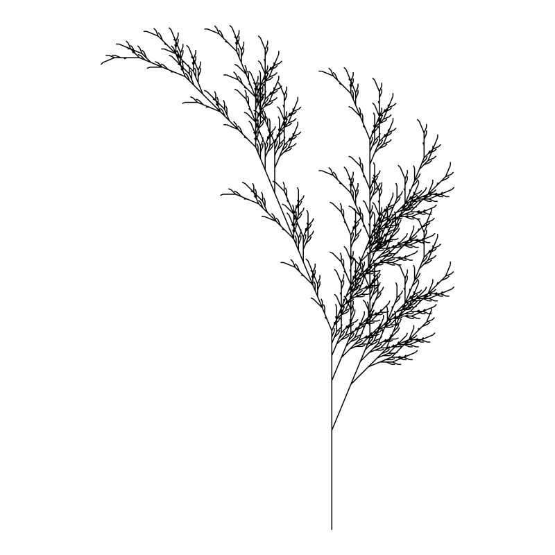
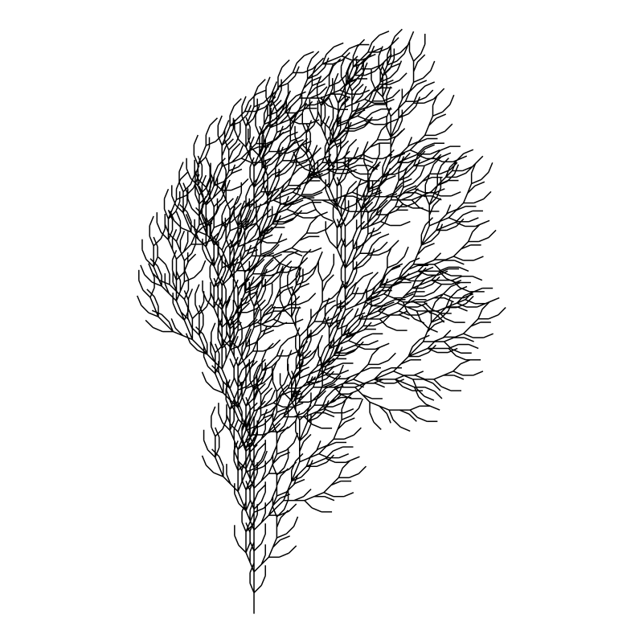
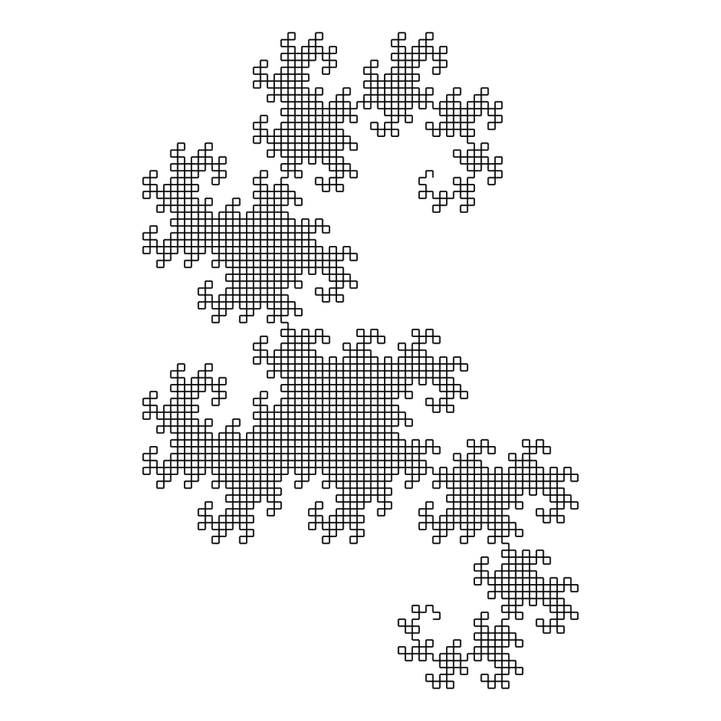
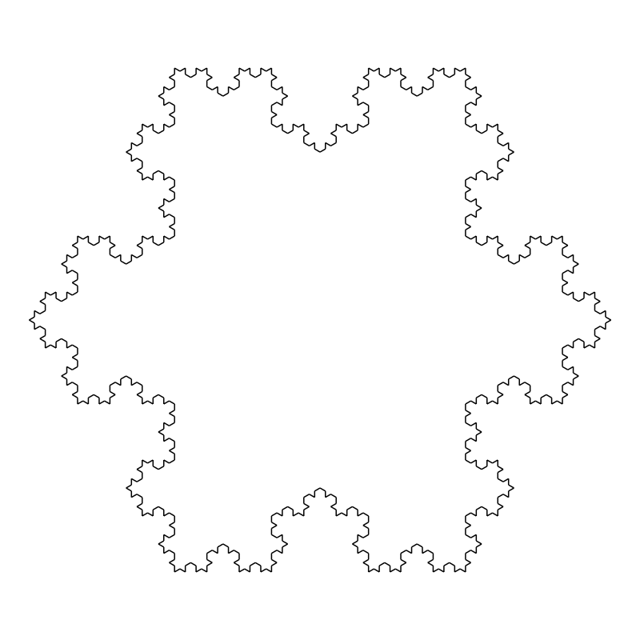
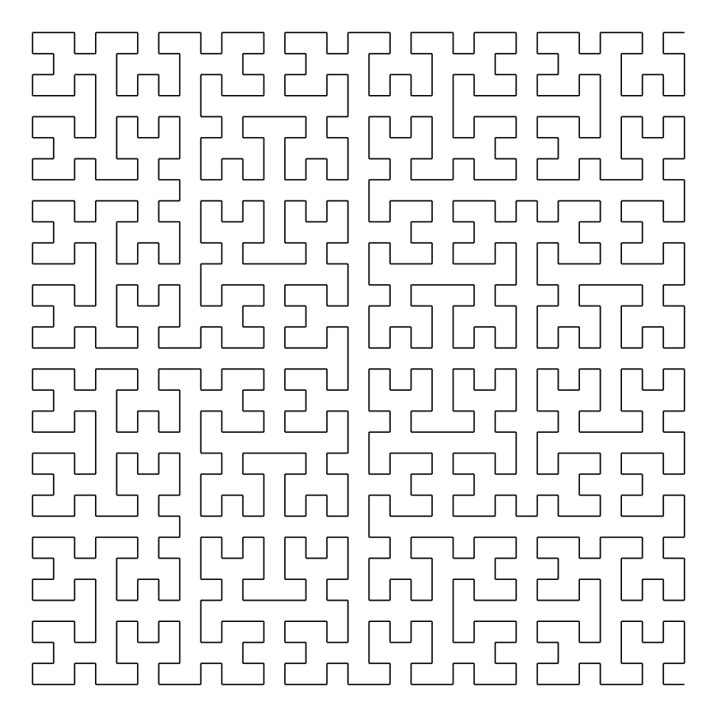
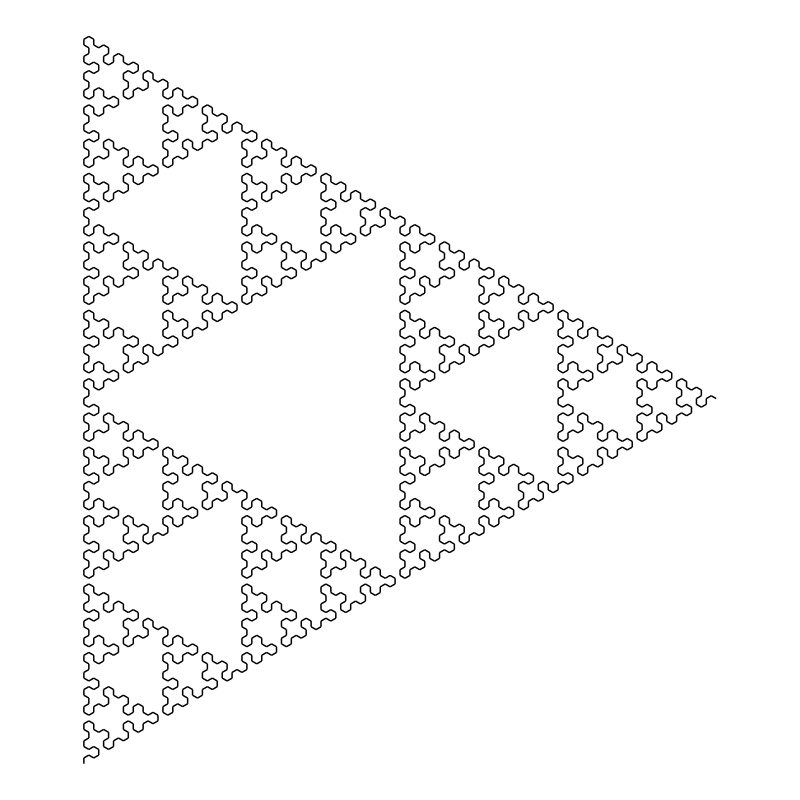
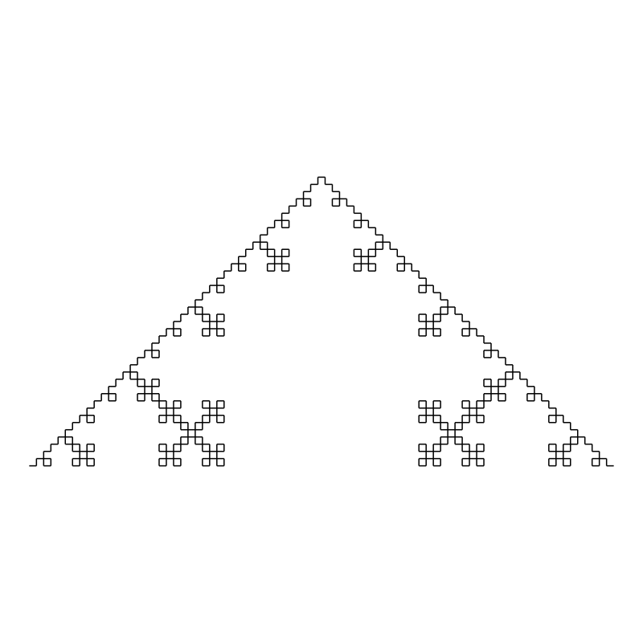

# Programming Exercise: L-systems and Turtle Graphics

In this exercise you will write a small Haskell program that draws pictures
like these:

| | | | |
|:---:|:---:|:---:|:---:|
|  |  |  |  |
|  |  |  | |

Every one of these pictures comes from a single line of rules and a few lines
of Haskell. There are no graphics libraries involved. Your program will write
the pictures out as text files in the SVG format, which any web browser can
display.

You will practise:

* recursion on lists and on **recursive data types**
* **higher-order functions** (`map`, `concatMap`, `iterate`, folds, ...)
* **polymorphism** and type-class constraints
* recursive functions that return **more than one result** (as a pair)

## Submission and marking

**Deadline: Monday 9 November 2026, 12:00 noon.**

This exercise is for your own benefit and will not count towards your final
mark. We will, however, assign your submission a numeric mark out of 40 (10 pts
for each of the 4 parts), as well as provide feedback where we feel this 
could be helpful.

You are free to work individually or in groups. Please record **all the
names and student IDs** of students in your group in the table at the top of
your file. Then please have **one group member submit the file on Canvas**,
together with `Extensions.hs` if you attempted any of the extensions (see
Part 5). We will give the same score to all group members. The exercise has been designed so
that the parts are relatively independent, which should aid you in dividing up the
tasks.

The extensions in Part 5 are entirely optional and are just for your own
benefit. We are happy to look at them and give feedback, but they do not count
towards the mark.

## Background

An **L-system** (named after the biologist Aristid Lindenmayer, who used them in
1968 to model the growth of algae) is a way of producing longer and longer
strings from a short starting string, called the **axiom**, by repeatedly
applying **rewriting rules**.

Here is Lindenmayer's original example. The axiom is `A`, and the rules are

```
A -> AB
B -> A
```

At each step, **every** symbol in the string is replaced by its right-hand side,
all at the same time:

```
generation 0:  A
generation 1:  AB
generation 2:  ABA
generation 3:  ABAAB
generation 4:  ABAABABA
generation 5:  ABAABABAABAAB
```

(Looking at the lengths of these strings, do you recognise the sequence?)

Strings by themselves are not very exciting. To get pictures, we read the
generated string as a list of instructions for a **turtle**: a pen that sits at
some point on the page, facing in some direction. `F` means "draw a line one
step forward", `+` means "turn left", `-` means "turn right", and so on. For
example, with a turning angle of 90 degrees the rule

```
F -> F+F-F-F+F
```

replaces every straight line by a line with a square bump in it. Repeating
this four times gives the Koch curve in the gallery above.

We add to this collection of moves the ability to insert brackets `[` and `]`,
which make the turtle draw **branches**. On `[` the turtle remembers where it is,
then draws the branch. On the matching `]` it jumps back to where it was. This 
is how the plant and the bush are drawn.

## Getting started

You are given three files:

* `LSystem.hs`: **the file you will edit.** It contains the types, the
  functions you must write (each currently `undefined`), a gallery of example
  L-systems, and a self-test.
* `Main.hs`: a small driver that writes the pictures to files. You do not need
  to change it (or understand it yet: it uses `IO`, which we will meet later).
* `README.md`: this file.

Work through `LSystem.hs` from top to bottom. To test what you have done so far:

```
$ ghci LSystem.hs
ghci> checks
rewrite: ok
step: ok
step (poly): not done yet (or crashed)
...
```

Note that the checks are there as a guide, but they are not exhaustive: your
function is not necessarily correct even if it passes all the checks.

Once all four parts are done, you can draw pictures:

```
$ runghc Main.hs              # draw everything in the gallery
$ runghc Main.hs plant        # draw just the plant
$ runghc Main.hs plant 3      # draw generation 3 of the plant
```

Each picture is written to a file such as `plant.svg`. Open it in a web
browser to look at it.

**Rules of the game.** Do not change the names or the types of the functions
in `LSystem.hs`: we will test your code against them. You may (and should) add
your own helper functions.

## Part 1: Rewriting

A set of rules is a list of pairs:

```hs
type Rules a = [(a, [a])]
```

The pair `(x, ys)` means "replace `x` by `ys`". If a symbol has no rule, it
stays as it is. Notice that `Rules` works for any type of symbol `a`, not only
characters. The rewriting functions you write should work for any type `a` that
supports `==`.

An L-system bundles together an axiom, its rules, and the information needed to
draw it:

```hs
data LSystem = LSystem
  { name  :: String      -- used as the output file name
  , axiom :: String      -- the starting string
  , rules :: Rules Char  -- the rewriting rules
  , angle :: Double      -- turning angle, in degrees
  , depth :: Int         -- how many generations look good
  }
```

This uses **record syntax**, which also defines a function for each field. For
example, `axiom koch` is the axiom of the Koch curve.

### Write the following functions:

1. `rewrite :: Eq a => Rules a -> a -> [a]`, which says what a single symbol is
   replaced by. *Hint:* check out the function `lookup` on [Hoogle](https://hoogle.haskell.org/).
2. `step :: Eq a => Rules a -> [a] -> [a]`, which does one generation.
3. `generations :: Eq a => Rules a -> [a] -> [[a]]`, the **infinite** list of
   all generations, starting from the axiom. Haskell only computes as much of an
   infinite list as you actually use, so `take 5 (generations ...)` is perfectly
   fine. *Hint:* check out the function `iterate` on [Hoogle](https://hoogle.haskell.org/).
4. `expand :: LSystem -> Int -> String`, calculate generation `n` of an L-system.

Try `map length (take 10 (generations (rules algae) "A"))`.

## Part 2: Turtle programs

Before we draw, we turn the string into a **program** for the turtle:

```hs
data Instr
  = Draw            -- move forward one step, drawing a line
  | Move            -- move forward one step without drawing
  | Turn Double     -- turn anticlockwise by this many degrees
  | Branch [Instr]  -- run a sub-program, then come back
```

This is a **recursive data type**: a `Branch` contains a whole program of its
own, which may contain more branches, and so on. The brackets in the string
become the tree structure of the program. For example, with angle 90,

```
"F[+F][-F[F]]F"
```

becomes

```hs
[ Draw
, Branch [Turn 90, Draw]
, Branch [Turn (-90), Draw, Branch [Draw]]
, Draw
]
```

The symbols mean:

| symbol     | instruction    |
|------------|----------------|
| `F`, `G`   | `Draw`         |
| `f`        | `Move`         |
| `+`        | `Turn a` (left by the angle `a`) |
| `-`        | `Turn (-a)` (right by the angle `a`) |
| `\|`       | `Turn 180`     |
| `[ ... ]`  | `Branch [...]` |
| anything else | nothing (it is ignored) |

Symbols such as `X`, `Y`, `A` and `B` are ignored by the turtle. They are only
there to control how the string grows.

### Write the following functions:


1. `symbol :: Double -> Char -> Maybe Instr`, the meaning of a single
   (non-bracket) symbol, given the turning angle.

2. `parseBlock :: Double -> String -> ([Instr], String)`. This is the heart of
   the parser. It reads instructions until it reaches an unmatched `]` or the
   end of the string, and returns **two** things: the instructions it read, and
   the rest of the string *after* that `]`:

   ```hs
   parseBlock 90 "F+F]G-X"  ==  ([Draw, Turn 90, Draw], "G-X")
   ```

   When `parseBlock` meets a `[`, it should call itself to read the branch. That
   call reads up to the matching `]` and hands back the rest of the string. Then
   carry on reading from there. Think carefully about each case: the empty
   string, `]`, `[`, and any other character.

3. `parse :: Double -> String -> [Instr]`, which turns a whole string into a
   program. (This should be very short.)

To get some practice with the new data type, also write:

4. `countDraws :: [Instr] -> Int`, the number of lines a program will draw.
5. `nesting :: [Instr] -> Int`, how deeply the branches are nested (`0` if
   there are none).
6. `simplify :: [Instr] -> [Instr]`, which tidies up a program **without
   changing the picture it draws**. It merges adjacent turns into a single turn,
   removes turns by 0 degrees, and removes empty branches (which do nothing).
   Branches should be simplified on the inside too. For example,
   `simplify (parse 90 "F+[]-F")` should be `[Draw, Draw]`.

## Part 3: The turtle

```hs
type Point = (Double, Double)
type Line  = (Point, Point)          -- from, to

data Turtle = Turtle Point Double    -- position, heading
```

The heading is in degrees, measured anticlockwise from the positive x-axis. So
0 means facing east, 90 means facing north, and so on. Every picture starts with
the turtle at the origin, facing north (this is `start`).

### Write the following functions:

1. `forward :: Turtle -> Turtle`, which moves the turtle one step (of length 1)
   in the direction it is facing. You will need `cos` and `sin`, which work in
   *radians*, not degrees.
2. `turn :: Double -> Turtle -> Turtle`.
3. `run :: Turtle -> [Instr] -> (Turtle, [Line])`, which runs a program. It
   returns where the turtle finishes, and every line it drew, in the order they
   were drawn. The interesting case is `Branch`. The turtle runs the branch,
   keeps the lines it drew, and then carries on **from where it was before the
   branch**, as if the branch had never moved it.

   (If you have seen L-systems before, you may have seen them drawn using a
   *stack* of saved turtles. Here you do not need one. Why not?)

4. `draw :: [Instr] -> [Line]`, all the lines drawn by a program, starting from
   `start`.

## Part 4: SVG output

An SVG file is a text file describing a picture. We will put all our lines in a
single `path`, whose drawing commands look like this:

```
M 0.00 0.00 L 1.00 0.00 M 1.00 0.00 L 1.00 -1.00
```

This means "move to (0, 0), draw a line to (1, 0), move to (1, 0), draw a line
to (1, −1)". There is one complication: in SVG, the y-axis points **down** the
page. So we flip every point when we write it out: the point `(x, y)` is
written as `x -y`.

We provide `num :: Double -> String`, which shows a number with exactly two
decimal places. 

### Write the following functions:

1. `bounds :: [Line] -> (Point, Point)`, the smallest box containing every line,
   as its bottom-left and top-right corners.
2. `svgPoint :: Point -> String`, which writes out one (flipped) point.
3. `svgPath :: [Line] -> String`, the drawing commands for all the lines.
4. `toSVG :: [Line] -> String`, the complete file. The exact format, including
   how to work out the `viewBox` (the part of the plane that is shown), is
   described in the comment in `LSystem.hs`. *Hint:* `unlines`.
5. `render :: LSystem -> Int -> String`, which puts everything together.

Now run `runghc Main.hs` and admire your gallery!

**Look at your pictures.** Passing `checks` is not enough. Open each of your
SVG files and compare it with the gallery at the top of this page. (Make sure
you are opening the files *your* program just wrote!) A picture that is
mirrored, tangled, curled up or blank is telling you that something is wrong.
Generate a smaller depth, e.g. `runghc Main.hs plant 2`, and work out by hand
what the turtle should do.

## Part 5: Extensions

The first four parts are the core of the exercise. If you have finished them,
choose one or more of the following extensions. They are optional and do not
count towards the mark, but we are happy to give feedback on them. They are deliberately
open-ended. You decide on the types and the names. Please put your extension
code in a separate file `Extensions.hs` that imports `LSystem`, and explain
what you did in a comment at the top.

**A. Your own L-systems.** Find (or invent) at least three new L-systems and
add them to the gallery. The book *The Algorithmic Beauty of Plants* by
Prusinkiewicz and Lindenmayer is
[freely available](http://algorithmicbotany.org/papers/#abop) and is full of
them. Chapter 1 is the place to start.

**B. Smaller files.** Most lines start exactly where the previous one ended,
but `svgPath` still writes an `M` for every line. Join runs of connected lines
into single commands such as `M p L q L r L s`, and measure how much smaller
the files get. (Be careful when comparing `Double`s for equality.)

**C. Thick trunks, thin twigs.** Real plants have thick trunks and thin twigs.
Keep track of how deeply nested each line is, and draw lines at each depth with
a different `stroke-width`, a different colour, or both. You will need a
version of `run` that remembers the depth, and one `path` per depth.

**D. Random plants.** In a *stochastic* L-system, a symbol can have several
rules, each with a weight, and one is chosen at random every time the symbol
is rewritten. For example, the following plant looks different every time:

```
F -> F[+F]F[-F]F    (weight 1)
F -> F[+F]F         (weight 1)
F -> F[-F]F         (weight 1)
```

Haskell functions cannot just "be random". The same input must always give the
same output. Instead, pass a *seed* around explicitly, and use a function like
the following to get the next pseudo-random number from the current one:

```hs
nextSeed :: Int -> Int
nextSeed s = (1103515245 * s + 12345) `mod` 2147483648
```

Design a type for stochastic rules and write a version of `step` for it. Make
sure every rewrite uses a fresh seed! Draw a small forest of different plants
from the same rules.

**E. Watch it grow.** Draw generations `0, 1, ..., n` of an L-system side by side
in a single SVG file. Each picture will need moving (and perhaps scaling) so
that they do not overlap.

**F. Round trip.** Write `unparse :: Double -> [Instr] -> String`, which turns a
program back into a string. Then convince yourself (and us) that
`parse a (unparse a p) == p` for a sensible class of programs `p`. Which `p` does it
fail for, and why?

**G. Beyond characters.** `step` already works for any type of symbol, but
`parse` only understands `Char`. Define a type class of symbols that the turtle
can interpret, make `Char` an instance, and write `parse` once for every
instance. Then design your own data type of symbols for one of the gallery
L-systems, so that a typo in the rules becomes a type error.

